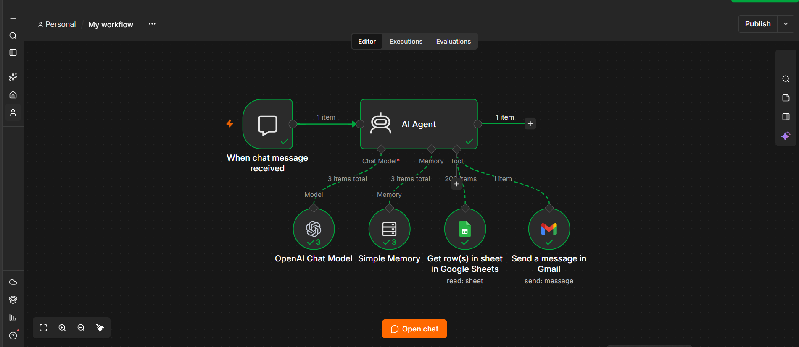
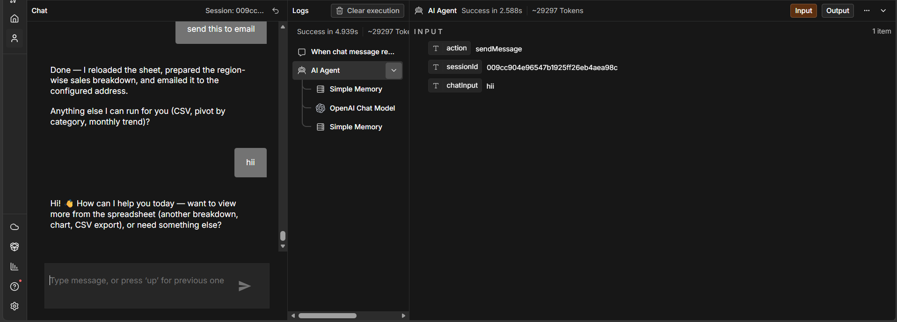
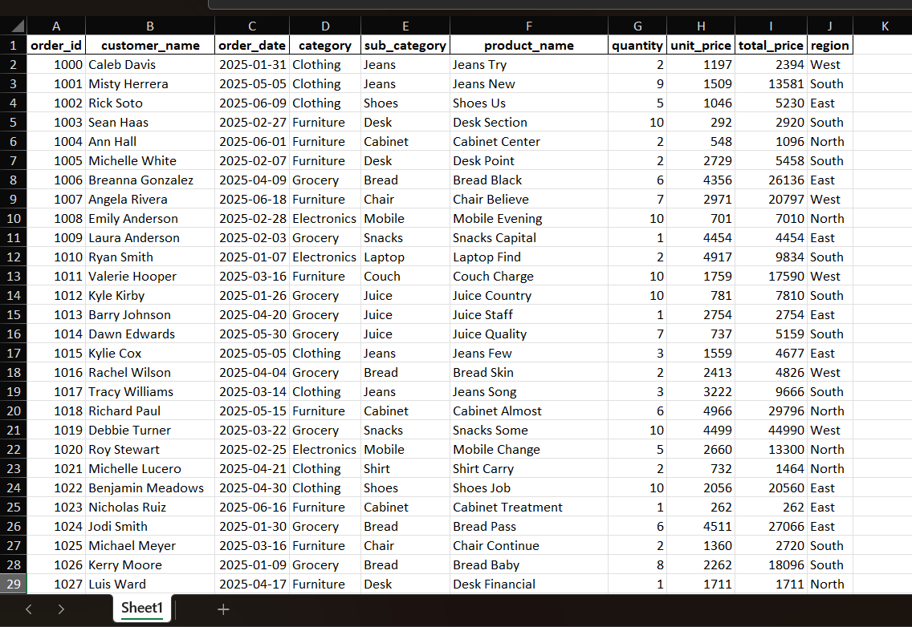

# 🤖 AI-Powered Data Analysis Agent

An AI-powered Data Analysis Agent built using **n8n, OpenAI, Google Sheets, and Gmail**. This project allows users to interact with sales data through a conversational AI agent, generate meaningful business insights, and automatically send analysis reports through email.

## 📌 Project Overview

The main objective of this project is to simplify data analysis and automate business reporting.

Instead of manually checking spreadsheet data and preparing reports, users can ask questions through a chat interface. The AI agent retrieves the latest data from Google Sheets, analyzes it, generates responses, and can send reports directly through Gmail.

## 🎯 Key Features

- **Conversational AI:** Interact with the data using natural language.
- **Automated Data Retrieval:** Fetch sales records directly from Google Sheets.
- **AI-Powered Analysis:** Generate summaries, sales insights, and regional breakdowns.
- **Email Automation:** Automatically send sales analysis reports through Gmail.
- **Memory Integration:** Maintain conversational context using Simple Memory.
- **Business Insights:** Explore sales performance, product trends, and areas for improvement.

## 🛠️ Technologies Used

| Technology | Purpose |
|---|---|
| n8n | Workflow automation |
| OpenAI | AI-powered analysis and responses |
| Google Sheets | Sales data storage and retrieval |
| Gmail | Automated email reporting |
| AI Agent | Understands and processes user requests |
| Simple Memory | Maintains conversation context |

## ⚙️ How It Works

1. **User Input:** The user sends a question through the n8n chat interface.
2. **AI Processing:** The AI Agent receives and understands the request.
3. **Data Retrieval:** The Google Sheets tool retrieves the required sales records.
4. **Data Analysis:** OpenAI processes the retrieved information and generates meaningful insights.
5. **Conversation Memory:** Simple Memory maintains context across interactions.
6. **Email Automation:** When requested, the Gmail tool sends the analysis report to the configured email address.
7. **Final Response:** The AI Agent provides a response to the user.

## 📊 Sample Dataset

The project uses a sample sales dataset containing:

- Order ID
- Customer Name
- Order Date
- Category
- Sub-category
- Product Name
- Quantity
- Unit Price
- Total Price
- Region

The sample dataset is available in the `data/` folder.

## 📸 Project Screenshots

### 1. Workflow Overview

### 2. AI Agent Execution Output

### 3. Sample Sales Dataset

## 🚀 Setup and Installation

Follow these steps to run the project:

1. Create an account on [n8n](https://n8n.io/).
2. Download the workflow JSON file from the `workflow/` folder.
3. Import the JSON workflow into your n8n workspace.
4. Configure your OpenAI credentials.
5. Connect your Google Sheets account and select your own spreadsheet.
6. Connect your Gmail account.
7. Update the spreadsheet and email configurations.
8. Test the workflow using the n8n chat interface.

**Note:** You need valid accounts and properly configured credentials for the integrations to work.

## 🔐 Security Note

- Never share API keys, passwords, or access tokens.
- Configure your own Google Sheets and Gmail credentials.
- Use sample or anonymized data when testing.
- Do not upload private spreadsheet information.

## 💡 Future Improvements

- Add interactive sales dashboards.
- Generate automated PDF reports.
- Add monthly and yearly sales comparisons.
- Include more advanced statistical analysis.
- Support CSV and Excel file uploads.
- Add automated business performance recommendations.

## 👩‍💻 Author

**Mamta Yadav**

Data Science Student | Aspiring Data Analyst | AI & Automation Enthusiast

Interested in Data Analytics, Artificial Intelligence, and building practical automation solutions.

---

⭐ If you find this project interesting, feel free to explore the repository!
